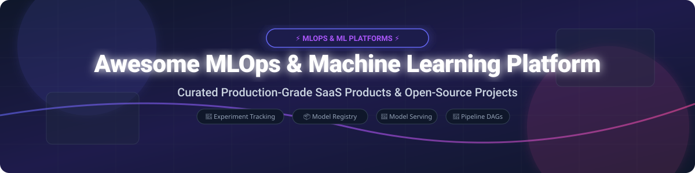

# 🚀 Awesome MLOps & Machine Learning Platform 🤖

   

> **A Curated List of SaaS Products & Open-Source GitHub Projects for Machine Learning Operations (MLOps), Experiment Tracking, Model Registries, Pipeline Orchestration & Production Model Serving.**

---

## 💡 Overview & Ecosystem Insights 🧠

This repository provides an end-to-end directory of top **SaaS platforms** and **open-source tools** engineered for modern **MLOps (Machine Learning Operations)** and **Machine Learning Platforms**. From data versioning and hyperparameter tuning to continuous training pipelines, feature stores, model registry, monitoring, and scalable model serving, these frameworks empower AI engineers and data science teams to manage the complete enterprise machine learning lifecycle efficiently.

---

## 📖 Table of Contents 📌

- [☁️ SaaS & Hosted Enterprise ML Platforms](#-saas--hosted-enterprise-ml-platforms)
- [🔓 Open-Source GitHub Projects & Frameworks](#-open-source-github-projects--frameworks)
- [🤝 How to Contribute](#-how-to-contribute)
- [💖 Support & Community](#-support--community)
- [⚠️ Disclaimer](#%EF%B8%8F-disclaimer)
- [⭐ Star History](#-star-history)

---

## ☁️ SaaS & Hosted Enterprise ML Platforms 🏢

> **📊 Estimated Market Size & Dynamics**: The global **MLOps market size** is estimated at **~$5.0 Billion in 2026** and is projected to expand toward **~$20.0 Billion by 2032** at a CAGR of ~26%. The market structure is **moderately fragmented**: cloud hyperscalers (**AWS SageMaker**, **Google Cloud Vertex AI**, **Microsoft Azure Machine Learning**) and unified lakehouse vendors (**Databricks**) command enterprise compute workflows, while best-of-breed specialized vendors (**Weights & Biases**, **DataRobot**, **Dataiku**, **Comet ML**, **Neptune.ai**, **Domino Data Lab**) compete fiercely on developer experience, experiment tracking, model evaluation, and governance. No single vendor holds a total winner-take-all monopoly.

| Platform 🚀 | Description 📝 | Pricing (Starting Tier) 💳 | Free Tier Limits / Free Trial 🆓 | Company Size (Valuation / Revenue) 📈 |
|:---|:---|:---|:---|:---|
| **[AWS SageMaker](https://aws.amazon.com/sagemaker/)** | **AWS's flagship managed ML platform.** Studio notebooks, distributed training, model registry, and scalable endpoints. | **Notebooks**: **$0.0464/hour** (`ml.t3.medium`). **Training/Inference**: Per compute instance-hour. | **AWS Free Tier**: **2 months free** (250 hours `ml.t3.medium`) for SageMaker Studio notebook + **$100–$200** credits for new AWS accounts. | **~$638B revenue** (Amazon FY2025) |
| **[Google Cloud Vertex AI](https://cloud.google.com/vertex-ai)** | **Google Cloud's unified AI/ML platform.** AutoML, custom training pipelines, Model Garden, and Endpoint deployment. | **Custom Compute**: **$0.0036/hour** (`n1-standard-2` node). **AutoML**: Per training hour + per prediction call. | **Google Cloud Free Tier**: **$300 credits valid for 90 days** applicable across Vertex AI workloads. | **~$350B revenue** (Alphabet FY2025) |
| **[Microsoft Azure Machine Learning](https://azure.microsoft.com/en-us/products/machine-learning/)** | **Enterprise cloud ML ecosystem.** Studio GUI, AutoML, pipeline designer, prompt flow, and Azure governance. | **Compute Instance**: **$0.084/hour** (`Standard_DS3_v2`) + standard storage/networking charges. | **Azure Free Account**: **$200 credit valid for 30 days** + 12 months of free Azure services (No perpetual free tier for AML compute). | **~$281B revenue** (Microsoft FY2025) |
| **[DataRobot](https://www.datarobot.com/)** | **Enterprise AI & MLOps platform.** Automated Machine Learning (AutoML), governance, guardrails, and decision intelligence. | **Essentials Tier**: **$1,500/month** (base cloud deployment tier) / Enterprise custom quote. | **14-day free trial** with full platform access and automated model building (No perpetual free tier). | **Private (~$6.3B valuation)** |
| **[Dataiku](https://www.dataiku.com/)** | **Collaborative data science & ML platform.** Low-code visual pipeline builder combined with full Python/R code flexibility. | **Free Edition**: **$0/month** (Up to 3 users, single server). **Enterprise**: Custom contract quote. | **Perpetual Free Edition**: **Up to 3 users**, 1 server, core visual & code features; **Enterprise Trial**: 30 days. | **Private (~$4.6B valuation)** |
| **[Databricks](https://www.databricks.com/)** | **Unified Lakehouse & AI platform.** Mosaic AI, managed MLflow integration, Feature Store, and serverless model serving. | **Serverless SQL**: **$0.70/DBU**. **All-Purpose Compute**: Starts from **~$0.40/DBU**. | **14-day free trial** on AWS/Azure/GCP cloud environments (No perpetual free tier). | **Private (~$3.5B annual revenue est.)** |
| **[Weights & Biases](https://wandb.ai/)** | **Developer-first MLOps & LLMOps platform.** Experiment tracking, hyperparameter sweeps, artifacts, and evaluation reports. | **Teams Plan**: **$50/month per seat**. **Enterprise**: Custom volume billing. | **Perpetual Free Tier**: **Personal use**, **100 GB artifact storage**, unlimited experiment tracking; **Academic**: Free for students/researchers. | **Private (~$1.25B valuation)** |
| **[Domino Data Lab](https://www.dominodatalab.com/)** | **Enterprise MLOps platform.** Reproducible model development, cloud compute orchestration, and model deployment governance. | **Standard Cloud**: **$250/user/month** (plus underlying compute infrastructure costs) / Custom Enterprise. | **14-day free trial** sandbox access for enterprise evaluation (No perpetual free tier). | **Private (~$1.0B+ valuation)** |
| **[Comet ML](https://www.comet.com/)** | **Experiment tracking & model registry platform.** Real-time logging, dataset versioning, model monitoring, and visualizations. | **Pro Plan**: **$99/month per seat**. **Enterprise**: Custom quotes. | **Perpetual Free Tier**: **1 user**, **100 GB storage**, unlimited experiments; **Academic**: Free for qualified researchers. | **Private (~$50M+ total funding raised)** |
| **[Neptune.ai](https://neptune.ai/)** | **Experiment tracker tailored for foundation models.** Neptune Scale for large-scale training monitoring and metadata storage. | **Individual/Base Plan**: **$49/month per seat**. **Scale Tier**: Custom throughput pricing. | **Perpetual Free Tier**: **100 GB storage** for individual researchers; **30-day free trial** for Neptune Scale team tier. | **Private (~$30M+ total funding raised)** |

---

## 🔓 Open-Source GitHub Projects & Frameworks 🛠️

Below is a comprehensive list of production-proven open-source MLOps, pipeline orchestration, model serving, feature store, and model monitoring repositories, sorted by **GitHub Star Count (Descending)** 🌟.

| Open-Source Project 📦 | Description 📜 | GitHub Stars Badge ⭐ |
|:---|:---|:---:|
| **[Apache Airflow](https://github.com/apache/airflow)** | **De-facto workflow orchestration platform.** Programmatically author, schedule, and monitor data & ML pipelines using Python DAGs. |  |
| **[Ray](https://github.com/ray-project/ray)** | **Unified distributed compute framework for AI scaling.** Includes **Ray Train**, **Ray Tune** (hyperparameter tuning), and **Ray Serve** (scalable model serving). |  |
| **[MLflow](https://github.com/mlflow/mlflow)** | **De-facto standard for ML lifecycle management.** Centralized experiment tracking, model registry, artifact storage, and multi-framework deployment. |  |
| **[Kubeflow](https://github.com/kubeflow/kubeflow)** | **Kubernetes-native cloud-private ML toolkit.** Provides Kubeflow Pipelines, Katib (hyperparameter tuning), Notebooks, and training operators on K8s. |  |
| **[DVC (Data Version Control)](https://github.com/iterative/dvc)** | **Git-like data and model version control.** Track massive datasets and ML models in cloud storage (S3/GCP/Azure) via lightweight Git pointer files. |  |
| **[Optuna](https://github.com/optuna/optuna)** | **Hyperparameter optimization framework.** Next-generation automated search space pruning with define-by-run API for PyTorch/XGBoost. |  |
| **[Kedro](https://github.com/kedro-org/kedro)** | **Production-grade data science code structure.** Modular pipeline abstraction, data catalog, and reproducible workflow framework backed by McKinsey. |  |
| **[Prefect](https://github.com/PrefectHQ/prefect)** | **Modern workflow orchestration framework.** High-performance Python-native pipeline engine with dynamic task graphs and hybrid execution. |  |
| **[Dagster](https://github.com/dagster-io/dagster)** | **Asset-based data and ML orchestrator.** Focuses on software-defined assets, lineage, and data quality testing across machine learning pipelines. |  |
| **[BentoML](https://github.com/bentoml/BentoML)** | **Unified AI model serving & packaging framework.** Packages models into "Bentos" with REST/gRPC endpoints for fast Docker and Kubernetes deployment. |  |
| **[Metaflow](https://github.com/Netflix/metaflow)** | **Human-centric ML infrastructure framework.** Developed originally at Netflix to build and manage real-world data science & ML projects. |  |
| **[ClearML](https://github.com/allegroai/clearml)** | **Auto-magical open-source MLOps suite.** Integrated experiment tracking, pipeline orchestration, data management, and GPU compute scheduling. |  |
| **[Feast](https://github.com/feast-dev/feast)** | **Production open-source feature store.** Manages feature definitions, serves features for low-latency inference, and prevents training-serving skew. |  |
| **[Evidently](https://github.com/evidentlyai/evidently)** | **ML model monitoring & data quality framework.** Evaluates data drift, model performance degradation, and generates real-time telemetry reports. |  |
| **[KServe](https://github.com/kserve/kserve)** | **Kubernetes-native serverless model inference.** High-performance inference control plane supporting PyTorch, TensorFlow, XGBoost, and vLLM engines. |  |
| **[ZenML](https://github.com/zenml-io/zenml)** | **Extensible MLOps framework.** Portable pipelines connecting local development to AWS, GCP, Azure, Kubeflow, Airflow, and MLflow stacks. |  |

---

## 🤝 How to Contribute 🛠️

Contributions are warmly welcome to keep this directory up to date! 

1. **Fork** this repository.
2. Add your suggested SaaS product or open-source repo into the appropriate table adhering to the established formatting guidelines.
3. Ensure open-source additions include the standard **GitHub Stars Badge** linked to `/stargazers`.
4. Open a **Pull Request (PR)** with a clear explanation of why the tool is beneficial for the MLOps ecosystem.

---

## 💖 Support & Community ☕

If you find this repository helpful for your MLOps architecture research or enterprise decision-making:
- **Star** 🌟 this repository to help others discover it!
- **Share** 📢 with your fellow ML Engineers, Data Scientists, and DevOps colleagues.
- **Sponsor** ☕ Support ongoing open-source research and maintenance via the [Sponsor Dashboard](https://github.com/sponsors/ishandutta2007).

Thank you for supporting open-source MLOps! ❤️

---

## ⚠️ Disclaimer 📜

- This is a community-curated list compiled for educational and comparative research purposes.
- Machine Learning models handle sensitive data and compute workloads; always perform security audits and compliance evaluations before enterprise adoption.
- All product names, logos, and trademarks are property of their respective owners.

---

## ⭐ Star History

